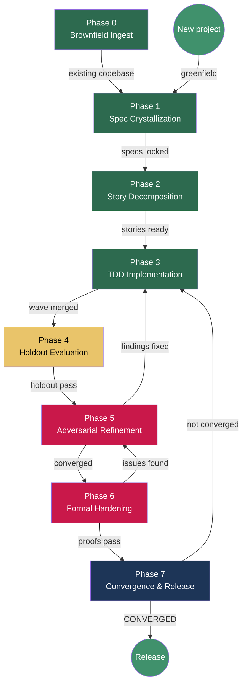

# vsdd-factory

**Verified Spec-Driven Development (VSDD) -- a dark factory for software, packaged as a Claude Code plugin.**

[](LICENSE)
[](CHANGELOG.md)

---

## What is VSDD?

Verified Spec-Driven Development is a software engineering methodology that fuses three
proven paradigms into a single AI-orchestrated pipeline:

- **Spec-Driven Development (SDD):** Define the contract before writing implementation.
  Behavioral contracts, verification properties, and domain models are the product -- code
  is the disposable artifact that implements them.
- **Test-Driven Development (TDD):** Tests are written before code. Red, Green, Refactor.
  No implementation code exists until a failing test demands it.
- **Verification-Driven Development (VDD):** Subject all surviving artifacts to adversarial
  review until the reviewer is forced to hallucinate flaws. Convergence is measured
  quantitatively across five dimensions, not declared subjectively.

The methodology produces software with full traceability from product brief through domain
model, behavioral contracts, acceptance criteria, test cases, implementation, and formal
proofs. Every line of code can answer "why does this exist?" by tracing back to a spec
requirement.

The VSDD contract chain traces every artifact through four specification levels:

```
L1 Product Brief
  -> L2 Domain Spec Capability (CAP-NNN)
    -> L3 Behavioral Contract (BC-S.SS.NNN)
      -> Story Acceptance Criterion (AC-NNN)
        -> Test Case
          -> Implementation
            -> L4 Verification Property (VP-NNN)
              -> Formal Proof
```

Quality is not declared by the builder -- it is measured by five independent convergence
dimensions (spec, tests, implementation, verification, holdout), each gated by quantitative
thresholds. The pipeline terminates when further adversarial review produces only hallucinated
findings.

## What does this plugin do?

The vsdd-factory plugin installs the complete VSDD pipeline into any Claude Code session:

- **Brownfield ingestion** -- analyze existing codebases before rebuilding or extending them
- **Spec crystallization** -- guided creation of product briefs, domain specs, PRDs, behavioral contracts, and architecture docs
- **Story decomposition** -- break specs into dependency-ordered, wave-scheduled implementation stories
- **TDD delivery** -- implement stories through specialist subagents (test-writer, implementer, demo-recorder, PR manager) with enforced Red Gate discipline
- **Adversarial refinement** -- fresh-context review by a different model family, iterated until convergence
- **Holdout evaluation** -- hidden acceptance scenarios evaluated by an information-asymmetric agent
- **Formal hardening** -- Kani proofs, fuzz testing, mutation testing, security scanning
- **Convergence gating** -- quantitative five-dimensional convergence assessment
- **Release management** -- changelog generation, merge to main, tagging, GitHub release

## Quick start

### Install from the marketplace

```shell
/plugin marketplace add bohica-labs/claude-mp
/plugin install vsdd-factory@claude-mp
```

> **Migrating from a pre-rc.7 install?** The marketplace was at
> `drbothen/vsdd-factory` through rc.6 but suffered from a silent
> install bug (see [`docs/guide/plugin-marketplace-architecture.md`](docs/guide/plugin-marketplace-architecture.md)
> for the full story). Run `/plugin marketplace remove vsdd-factory`
> first, then add `bohica-labs/claude-mp` and install via the new
> marketplace as shown above.

### Update to latest version

```shell
/plugin marketplace update claude-mp
/plugin update vsdd-factory@claude-mp
```

### Start every session with

```
/vsdd-factory:factory-health          # verify .factory/ worktree is mounted
/vsdd-factory:setup-env               # verify toolchain (first time or after changes)
```

Then read `.factory/STATE.md` to understand where the pipeline left off.

### Local development mode

```bash
claude --plugin-dir ./plugins/vsdd-factory
```

## Pipeline at a glance



## What's inside

| Category | Count | Description |
|----------|-------|-------------|
| **Agents** | 33 | Specialist personas + 10 orchestrator workflow files |
| **Skills** | 116 | Phase entry points, phase workflows, cross-cutting operations, design/UX, market intelligence, policy management, state health, input drift |
| **Commands** | 108 | Slash-command entry points — work skills have corresponding commands |
| **Hooks** | 26 | Enforcement layer (protect VPs, Red Gate, brownfield discipline, destructive command guard, branch protection, factory branch guard, VP consistency, subsystem names, BC titles, story-BC sync, template compliance, finding format, input-hash drift + format, state size, novelty assessment, convergence tracker, table cell count, changelog monotonicity, state pin freshness, index self-reference) |
| **Templates** | 99 | Output format definitions for every artifact type |
| **Workflows** | 16 | Lobster-as-data files defining phase and mode sequences |
| **Bin helpers** | 5 | Shell utilities (lobster-parse, research-cache, wave-state, multi-repo-scan, compute-input-hash) |
| **Rules** | 9 | Coding standards (Rust, Bash, git commits, spec format, step decomposition, etc.) |
| **Docs** | 5 | Methodology, factory protocol, convergence criteria, agent principles |

See [docs/guide/pipeline-overview.md](docs/guide/pipeline-overview.md) for the full phase map.

## Phase overview

| Phase | Entry command | Artifacts produced | Quality gate |
|-------|--------------|-------------------|-------------|
| **0 -- Brownfield Ingest** | `/vsdd-factory:brownfield-ingest <path>` | Per-pass analysis docs, synthesis, lessons | Extraction validation (behavioral + metric) |
| **1 -- Spec Crystallization** | `/vsdd-factory:create-brief`, `/vsdd-factory:create-domain-spec`, `/vsdd-factory:create-prd`, `/vsdd-factory:create-architecture` | Product brief, domain spec, PRD, BCs, VPs, architecture | Adversarial spec review (novelty decay) |
| **2 -- Story Decomposition** | `/vsdd-factory:decompose-stories` | Stories, epics, dependency graph, wave schedule, holdout scenarios | Human approval, adversary review |
| **3 -- TDD Implementation** | `/vsdd-factory:deliver-story STORY-NNN` | Implementation, tests, demo evidence, PRs | Wave gate (tests + adversarial + holdout) |
| **4 -- Holdout Evaluation** | `/vsdd-factory:holdout-eval` | Holdout evaluations, satisfaction scores | Mean satisfaction >= 0.85, must-pass >= 0.6 |
| **5 -- Adversarial Refinement** | `/vsdd-factory:adversarial-review implementation` | Finding reports, fix PRs | Novelty decay, min 3 clean passes |
| **6 -- Formal Hardening** | `/vsdd-factory:formal-verify`, `/vsdd-factory:perf-check` | Proof reports, fuzz results, mutation scores | All proofs pass, kill rate thresholds met |
| **7 -- Convergence** | `/vsdd-factory:convergence-check`, `/vsdd-factory:release` | Convergence report, changelog, GitHub release | All 7 dimensions CONVERGED |

## Directory structure

```
plugins/vsdd-factory/
  .claude-plugin/
    plugin.json              # Plugin manifest (name, version, license)
  agents/
    orchestrator/            # Orchestrator + 10 workflow reference files
    adversary.md             # 33 specialist agent definitions
    implementer.md
    test-writer.md
    ...
  skills/
    brownfield-ingest/       # 116 skill directories, each with SKILL.md
    deliver-story/
    factory-health/
    ...
  commands/                  # 108 slash-command wrappers
  hooks/
    hooks.json               # Hook wiring (PreToolUse, PostToolUse, SubagentStop, Stop)
    protect-vp.sh            # 26 enforcement hooks
    red-gate.sh
    ...
  bin/                       # 5 shell utilities
  workflows/                 # 16 Lobster workflow files (YAML-as-data)
  templates/                 # 99 artifact output templates
  rules/                     # 9 coding/process standard files
  docs/                      # Methodology and protocol docs
  tests/                     # bats test suites (520 tests across 17 suites)
  fixtures/                  # Test fixtures (smoke-project, policy-9, policy-enforcement)
```

## Development

### Prerequisites

- [bats-core](https://github.com/bats-core/bats-core) for running tests
- `jq` and `yq` for JSON/YAML processing
- `bash` 4+ with `set -euo pipefail` support

### Running tests

```bash
# All tests (534 across 17 suites)
bats plugins/vsdd-factory/tests/*.bats

# Individual suites
bats plugins/vsdd-factory/tests/hooks.bats              # 54 hook enforcement tests
bats plugins/vsdd-factory/tests/skills.bats              # 60 structural tests (Iron Laws, Red Flags, templates, policies)
bats plugins/vsdd-factory/tests/bin.bats                 # 13 bin helper tests
bats plugins/vsdd-factory/tests/visual-companion.bats    # 18 visual companion server tests
bats plugins/vsdd-factory/tests/permissions.bats         # 68 permission model + governance policy + structural completeness tests
bats plugins/vsdd-factory/tests/policy9.bats             # 13 VP-INDEX consistency hook tests
bats plugins/vsdd-factory/tests/destructive-guard.bats   # 51 destructive command guard tests
bats plugins/vsdd-factory/tests/policy-enforcement.bats  # 30 policy 6/7/8 enforcement hook tests
bats plugins/vsdd-factory/tests/hook-robustness.bats     # 35 hook robustness + error contract + shellcheck tests
bats plugins/vsdd-factory/tests/template-compliance.bats # 14 template compliance hook tests
bats plugins/vsdd-factory/tests/finding-format.bats      # 12 finding format validation tests
bats plugins/vsdd-factory/tests/input-hash.bats          # 31 input-hash drift + cluster triage tests
bats plugins/vsdd-factory/tests/input-hash-scan.bats     # 22 batch scan + resolve + path consistency tests
bats plugins/vsdd-factory/tests/state-health.bats        # 33 STATE.md size enforcement + state health tests
bats plugins/vsdd-factory/tests/novelty-assessment.bats  # 18 novelty assessment format validation tests
bats plugins/vsdd-factory/tests/convergence-tracker.bats # 17 convergence rule enforcement tests
bats plugins/vsdd-factory/tests/corpus-lint.bats         # 45 corpus lint hook tests (table cells, changelog, pin freshness, self-ref)
```

### Syntax checking

```bash
for f in plugins/vsdd-factory/hooks/*.sh plugins/vsdd-factory/bin/*; do
  bash -n "$f"
done
```

### CI

GitHub Actions runs on every push and PR to main. The workflow installs tools, shellcheck-validates
all shell scripts, runs all 17 bats test suites, validates JSON manifests, and parses
every Lobster workflow file. See `.github/workflows/plugin-validation.yml`.

## Documentation

| Guide | Description |
|-------|-------------|
| [Getting Started](docs/guide/getting-started.md) | Installation, first session, first project |
| [Workflow Modes](docs/guide/workflow-modes.md) | All 8 workflow modes — when to use each, what phases they run |
| [Pipeline Paths](docs/guide/pipeline-paths.md) | All 14 routing paths through the factory with step traces |
| [Pipeline Overview](docs/guide/pipeline-overview.md) | Full phase map with Mermaid diagrams |
| [Configuration](docs/guide/configuration.md) | Factory directory layout, STATE.md, hooks, templates |
| [Troubleshooting](docs/guide/troubleshooting.md) | Common issues and fixes |
| [Visual Companion](docs/guide/visual-companion.md) | Browser-based mockups, excalidraw diagrams, interactive design |
| [Glossary](docs/guide/glossary.md) | VSDD terminology reference |
| [Policy Reference](docs/guide/policy-reference.md) | Governance policies, enforcement matrix, violation playbooks |
| [ID Reference](docs/guide/id-reference.md) | All 30 identifier formats with scope, producer, registry, validation |
| [Hooks Reference](docs/guide/hooks-reference.md) | Hook scripts — trigger behavior, instrumentation status, debugging |
| [Observability](docs/guide/observability.md) | Event log schema, reason-code registry, query recipes, local Docker stack (Loki + Prometheus + Grafana, 7 dashboards), multi-factory registry |
| [Agents Reference](docs/guide/agents-reference.md) | Agent permission model, status protocol, all 33 agents |

### v1.0 Factory Plugin Kit (in progress)

| Doc | Description |
|-----|-------------|
| [v1.0 Index](docs/guide/v1.0-index.md) | Landing page for the v1.0 docs set; links the five below. |
| [Authoring Hooks](docs/guide/authoring-hooks.md) | Writing WASM hooks against the v1.0 SDK — skeleton, populated as Phase 1–3 stories ship. |
| [Porting Bash Hooks to WASM](docs/guide/porting-bash-hook-to-wasm.md) | Walkthrough for porting an existing v0.79.x hook — skeleton, populated as Phase 3 ports land. |
| [Migrating from 0.79.x](docs/guide/migrating-from-0.79.md) | Operator-facing upgrade guide for v0.79.x → v1.0 dispatcher migration. |
| [Semver Commitment](docs/guide/semver-commitment.md) | v1.0 stability guarantees — what's stable, what's not, breaking change policy. |
| [Observability Sinks](docs/guide/observability-sinks.md) | Multi-backend telemetry config — skeleton, populated as Phase 1 + 4 sink drivers ship. |

### Internal reference docs (in the plugin)

| Doc | Description |
|-----|-------------|
| [VSDD.md](plugins/vsdd-factory/docs/VSDD.md) | The full VSDD methodology |
| [FACTORY.md](plugins/vsdd-factory/docs/FACTORY.md) | Factory protocol and operating rules |
| [AGENT-SOUL.md](plugins/vsdd-factory/docs/AGENT-SOUL.md) | Principles governing all agents |
| [CONVERGENCE.md](plugins/vsdd-factory/docs/CONVERGENCE.md) | Quantitative convergence criteria |

## License

[MIT](LICENSE)

## Contributing

Contributions are welcome. Before submitting a PR:

1. **Read the Iron Laws.** Nine critical skills each have an Iron Law and a Red Flags table
   (80 entries total). These are empirically anchored -- do not weaken them without eval evidence.

2. **Run the test suite.** All 534 bats tests must pass. New skills need structural tests
   for any Iron Laws, Red Flags, or template references they introduce.

3. **Use portable template paths.** Reference templates as
   `${CLAUDE_PLUGIN_ROOT}/templates/<name>.md`, never `.claude/templates/`. This is
   enforced by regression tests.

4. **Follow conventional commits.** `feat(scope): description`, `fix(scope): description`.
   No AI attribution in commit messages.
